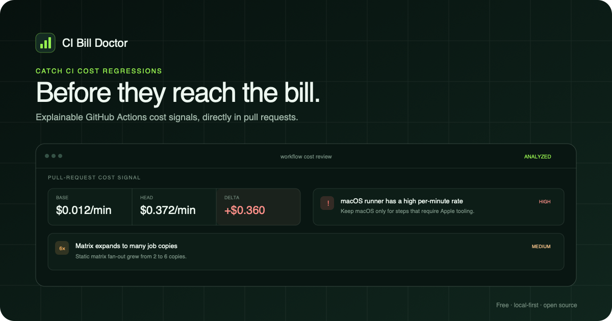

[English](README.md) | Español

# CI Bill Doctor

**Detectá regresiones de costo de GitHub Actions antes del merge.**

Identificá cuando un pull request expande una matriz, mueve jobs a macOS o
Windows, amplía triggers o elimina protecciones de CI, mientras el cambio todavía
se puede revisar.

- Solo lectura por defecto.
- No se envían código fuente, logs ni artifacts a CI Bill Doctor.
- Sin cuenta, backend, modelo de IA ni telemetría de CI Bill Doctor.

[Probar el scanner web](https://seba-montero.github.io/ci-bill-doctor/) ·
[Instalar en 2 minutos](#instalación-en-2-minutos) ·
[Ver un reporte validado](https://github.com/seba-montero/ci-bill-doctor-lab/pull/2) ·
[Ver en Marketplace](https://github.com/marketplace/actions/ci-bill-doctor)

[](https://github.com/seba-montero/ci-bill-doctor-lab/pull/2)

_Ilustración basada en un resultado validado del laboratorio público. Las cifras
son señales brutas equivalentes a precios de lista, no facturas._

## Instalación en 2 minutos

Creá `.github/workflows/ci-bill-doctor.yml` en la rama por defecto:

```yaml
name: CI cost guard

on:
  pull_request:
    paths:
      - ".github/workflows/**"

permissions:
  contents: read
  pull-requests: read

jobs:
  inspect:
    runs-on: ubuntu-latest
    timeout-minutes: 5
    steps:
      - uses: seba-montero/ci-bill-doctor@v0
```

No requiere checkout. En el próximo pull request que modifique directamente un
archivo de `.github/workflows`, abrí el resumen del job **CI cost guard**.

El primer reporte incluye:

- tarifa base y propuesta de runners alojados por minuto de workflow;
- hallazgos introducidos y resueltos;
- severidad, confianza, evidencia y recomendación por hallazgo;
- supuestos explícitos cuando un runner, matriz o precio no puede modelarse.

Comentarios, historial y bloqueo de merge permanecen deshabilitados. Para máxima
estabilidad de supply chain se puede fijar el SHA completo de `v0.2.0` en lugar
del tag móvil `v0`.

## Probar sin instalar

El [scanner gratuito](https://seba-montero.github.io/ci-bill-doctor/) analiza o
compara YAML localmente en la pestaña actual.

- Usa el mismo núcleo determinístico que la CLI y la Action.
- El workflow no se sube, persiste, registra ni envía a analytics.
- Las expresiones dinámicas quedan como desconocidas; no se ejecutan ni adivinan.
- El límite es 250 KB por workflow para proteger la pestaña.

## Qué detecta

| Señal | Ejemplo | Por qué importa |
|---|---|---|
| Runners caros | Mover jobs portables de Linux a macOS o Windows | Las tarifas públicas son muy diferentes |
| Expansión de matrices | Pasar de 2 a 12 combinaciones | Cada combinación puede crear otro job |
| Triggers duplicados | `push` y `pull_request` amplios | El mismo commit puede ejecutarse dos veces |
| Falta de cancelación | Sin `concurrency.cancel-in-progress` | Runs reemplazados pueden seguir consumiendo minutos |
| Falta de timeout | Un job sin `timeout-minutes` | Un proceso colgado puede llegar al límite de plataforma |
| Oportunidad de caché | Instalación sin caché visible | El setup repetido puede aumentar duración |
| Costo desconocido | Runner dinámico, reusable, larger, custom o self-hosted | Desconocido nunca se trata como cero |

El motor de decisión es determinístico y no usa IA.

## Historial, comentarios y enforcement opcionales

El reporte estático solo necesita `contents: read` y `pull-requests: read`.
El contexto mensual y los comentarios son opt-in independientes:

```yaml
permissions:
  actions: read
  contents: read
  pull-requests: write

jobs:
  inspect:
    runs-on: ubuntu-latest
    timeout-minutes: 5
    steps:
      - uses: seba-montero/ci-bill-doctor@v0
        with:
          history: "true"
          comment: "true"
          fail-on: "high"
```

| Capacidad | Default | Permiso adicional | Comportamiento |
|---|---|---|---|
| Step Summary | Activo | Ninguno adicional | Publica el reporte sin escribir en el PR |
| Contexto histórico | Inactivo | `actions: read` | Lee metadata acotada y la procesa en memoria |
| Comentario | Inactivo | `pull-requests: write` | Crea o actualiza un único comentario |
| Umbral de falla | `none` | Ninguno | Puede fallar en `high`, `medium`, `low` o `info` |

Si el historial falla por permisos, rate limits, datos incompletos o runners sin
precio, la Action conserva el reporte estático y explica el fallback.

## Cómo funciona la estimación

La señal estática principal es:

```text
tarifa pública del runner × copias estáticas de la matriz
```

El catálogo beta cubre runners estándar Linux, Windows y macOS. No incorpora
cuotas, descuentos, créditos, impuestos, larger runners ni costos custom de
self-hosted.

Con `history: "true"`, CI Bill Doctor muestrea metadata de runs y jobs completados
en una ventana acotada de 7–90 días. Estima frecuencia y costo observado, y
construye un escenario mensual bruto equivalente. Cambios de triggers, cobertura
incompleta o matrices aproximadas suprimen cifras futuras no justificadas.

La [metodología y sus límites](docs/methodology.md) documenta fórmulas, muestreo,
presupuestos de API y reglas de confianza.

## Privacidad y seguridad

El producto público no tiene un backend de CI Bill Doctor.

- Los workflows base/head se leen mediante los SHA inmutables del evento.
- Los forks se leen dentro del alcance del repositorio base.
- El historial consulta metadata, nunca logs ni artifacts.
- Los datos históricos se procesan en memoria y el reporte conserva agregados.
- No se envían a CI Bill Doctor YAML, código, tokens, IDs ni nombres privados.
- La configuración por defecto no tiene permisos de escritura.

No uses `pull_request_target`. Reportá vulnerabilidades mediante
[Private Vulnerability Reporting](https://github.com/seba-montero/ci-bill-doctor/security/advisories/new),
no mediante un issue público. El contrato completo está en [SECURITY.md](SECURITY.md).

## Estado de la beta validada

Versión actual: **v0.2.0**.

El gate de la release v0.2 incluye:

- 50 pruebas automatizadas del core, adaptadores, laboratorio y frontera web;
- checks con Node.js 22 y smoke del bundle productivo con Node.js 24;
- builds reproducibles y auditoría sin vulnerabilidades conocidas al
  2 de agosto de 2026;
- comparación base/head, expansión de matriz, cambios de triggers, proyección
  histórica, comentario idempotente y umbral de falla.

El bundle de la Action v0.2 es idéntico byte por byte al bundle v0.1.0 validado
remotamente. Por eso se reutilizan sus pruebas normales, de permisos mínimos,
fallback privado y forks, sin extender ese resultado a la nueva superficie web.
El hash y la evidencia están en el
[reporte de validación remota](docs/remote-validation.md). La confianza beta
queda limitada a `medium` hasta completar backtesting.

Todavía no incluye:

- conciliación exacta de factura, cuotas, descuentos o larger runners;
- historial longitudinal persistente ni ahorro verificado;
- parches automáticos;
- dashboard, cuenta, autenticación o facturación;
- soporte para GitLab, CircleCI o Buildkite.

## Feedback sin reuniones

- [Contar si un resultado sanitizado fue útil](https://github.com/seba-montero/ci-bill-doctor/issues/new?template=result-feedback.yml)
- [Elegir la primera capacidad alojada](https://github.com/seba-montero/ci-bill-doctor/issues/new?template=hosted-interest.yml)
- [Reportar un bug reproducible](https://github.com/seba-montero/ci-bill-doctor/issues/new?template=bug-report.yml)
- [Hacer una consulta de uso sanitizada](https://github.com/seba-montero/ci-bill-doctor/issues/new?template=usage-question.yml)

Los issues son públicos. Nunca incluyas YAML privado, nombres de repositorios,
tokens, logs, artifacts, datos de facturación ni información confidencial.
Los formularios están disponibles inicialmente en inglés.

## Desarrollo local

Requisitos: Node.js 22.22.2, fijado en `.nvmrc`, y npm.

```bash
nvm use
npm install
npm test
npm run build
```

Comandos útiles:

```bash
# Analizar o comparar workflows
npm run cli -- analyze .github/workflows/ci.yml
npm run cli -- compare test/fixtures/base.yml test/fixtures/head.yml

# Abrir el scanner web local
npm run dev:site

# Ejecutar el gate integral
npm run check
```

El bundle de la Action usa Node.js 24. El scanner es un build estático de Vite,
sin servidor.

## Modelo open-core

Parser, motor determinístico, CLI, scanner y Action se distribuyen con
[licencia MIT](LICENSE). El producto gratuito funciona sin cuenta ni backend.

Un futuro servicio privado puede monetizar historial durable, agregación,
políticas y reportes programados. La frontera comercial es persistencia y
coordinación, no ocultar el primer análisis útil.

Ver [decisión open-core](docs/decisions/0001-open-core-mit.md),
[frontera de historial efímero](docs/decisions/0002-ephemeral-history.md),
[core público/plataforma privada](docs/decisions/0003-public-core-private-cloud.md)
y [política de marca](TRADEMARKS.md).

## Documentación

- [Metodología y límites](docs/methodology.md)
- [Estado actual](docs/current-status.md)
- [Arquitectura](docs/architecture.md)
- [Especificación de producto](docs/product-spec.md)
- [Laboratorio consumidor](lab/README.md)
- [Validación remota](docs/remote-validation.md)
- [Seguridad](SECURITY.md)
- [Licencias de terceros](THIRD_PARTY_NOTICES.md)
